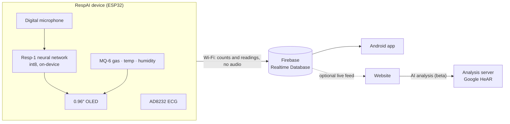
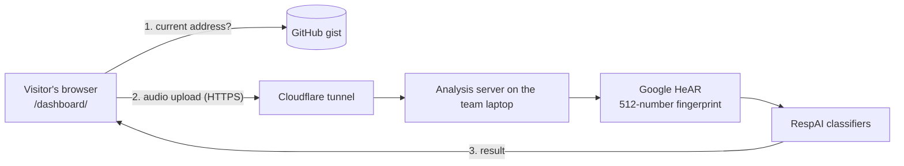

<div align="center">

# RespAI

**Patient and environment monitoring in one small device**
ECG · cough detection and classification · room air quality

Built in Uzbekistan by team **Invenio** · [respai.uz](https://respai.uz) · [Pitch deck (PDF, Uzbek)](docs/RespAI_prezentatsiya.pdf)

</div>

---

## Contents

1. [What RespAI is](#what-respai-is)
2. [The problem](#the-problem)
3. [How the system fits together](#how-the-system-fits-together)
4. [The device](#the-device)
5. [The website](#the-website)
6. [AI cough analysis (beta)](#ai-cough-analysis-beta)
7. [Running the website](#running-the-website)
8. [Market and business model](#market-and-business-model)
9. [Team](#team)
10. [Limitations, privacy and medical disclaimer](#limitations-privacy-and-medical-disclaimer)
11. [Credits and licences](#credits-and-licences)

---

## What RespAI is

RespAI is a desk-sized device for clinic wards and patients' homes. It does three things at once:

| | What it measures | Why it matters |
|---|---|---|
| **Heart** | Continuous ECG (AD8232 front end) | Heart rhythm between doctor visits |
| **Cough** | Counts and classifies coughs with a neural network that runs on the device | Cough frequency is an early sign that a respiratory illness is getting worse |
| **Room** | Temperature, humidity, flammable gas (MQ‑6), air composition | The air a patient breathes affects recovery |

Results appear on the device's own screen and in the Android app, so a doctor can follow the patient in real time.
Audio is analysed on the device and is **never recorded or uploaded**.

| Key figures | |
|---|---|
| Resp‑1 cough model accuracy (test set) | **89.58%** |
| Inference time, int8, Cortex‑M4F @ 80 MHz | 164 ms |
| Peak RAM, int8 | 15.4 KB |
| Audio sent to a server by the device | **0 bytes** |

## The problem

**Patients discharged from hospital are not monitored enough.**

1. **Patients are not followed regularly.** Follow-up usually relies on what the patient remembers and on occasional check-ups.
2. **The room environment is overlooked.** Temperature, humidity and dust in the air need constant monitoring.

In Uzbekistan, 1.5–2 million cases of influenza and acute respiratory infection are recorded every year (Ministry of Health),
fine-dust levels (PM2.5 / PM10) keep rising in Tashkent, the Fergana Valley, Navoi and Almalyk, and the WHO classifies the country
as medium risk for air quality.

## How the system fits together



| Part | Where it lives | Tech |
|---|---|---|
| Device firmware | ESP32 (maintained separately) | Edge Impulse model `cough_v4_int8`, Firebase client |
| Android app | `../app` in the team workspace | Kotlin WebView shell + HTML UI, Firebase Realtime Database |
| **Website** | **this repository** | React, TypeScript, Vite, three.js |
| AI analysis server | `../ai-server` on the team laptop | Python, FastAPI, Google HeAR, scikit-learn |

## The device

### Hardware

| Component | Part | Role |
|---|---|---|
| Microcontroller | ESP32 (Wi‑Fi) | Runs the cough model, reads the sensors, syncs to Firebase |
| Microphone | Digital microphone | Listens to the room continuously |
| ECG | AD8232 front end | Continuous heart signal |
| Gas sensor | MQ‑6 | LPG, propane, butane, methane |
| Climate | Temperature and humidity sensor | Room climate |
| Display | 0.96″ OLED, 128 × 64 | Live status on the device itself |
| Alerts | Piezo buzzer | Medication reminders and gas alerts |
| Controls | Rotary knob, USB‑C | |
| Enclosure | 3D-printed PLA, 100 × 100 × 15 mm | White shell, grey lid with embossed branding |

### How the device hears a cough

```
microphone ─▶ short overlapping windows ─▶ mel spectrogram ─▶ 8-bit neural network ─▶ cough / noise ─▶ count, log, sync
```

1. **Listen.** The microphone samples the room continuously.
2. **Window.** Audio is cut into short, overlapping windows.
3. **Spectrogram.** Each window becomes a mel spectrogram: a picture of how the sound energy is spread across frequencies.
4. **Classify.** A compact int8 neural network, trained in Edge Impulse on labelled cough and background-noise recordings, scores the picture.
5. **Count.** Coughs are counted and logged on the device, then the count (not the audio) is synced to Firebase.

### What the screen shows

```
WiFi:OK  FB:OK          connection to Wi‑Fi and Firebase
[~~~~~~]  p=0.84        live probability that the sound is a cough
          cough C:1     current label and running cough count
RMS: ▬▬▬▬▬▬▬▬▬▬         input level
T:26.8C H:35% MQ6:0.0   temperature, humidity, gas reading
```

### Android app

`app/` (package `uz.laputa.respai`, min SDK 28) is a Kotlin `WebView` shell around an HTML interface, with the Firebase Realtime
Database SDK included. The page exposes `onCoughDetected(...)` and `updateEnv(...)` so the native side can push cough events and
environment readings, and shows total coughs, coughs in the last hour, gas levels and a simple health summary.

## The website

A single-page product site plus an AI dashboard, available in **English, Uzbek and Russian**.
It is a static site: everything except the optional AI analysis runs in the visitor's browser.

### Stack

| | |
|---|---|
| UI | React 19, TypeScript, Vite 8 (two pages: `/` and `/dashboard/`) |
| 3D | three.js through `@react-three/fiber` and `@react-three/drei` |
| Motion | GSAP + ScrollTrigger, Lenis smooth scrolling |
| State | zustand |
| Fonts | Inter Tight, Geist Mono (self-hosted via Fontsource), Poppins for the 3D lettering |

### Page sections

| Section | Component | What it does |
|---|---|---|
| Hero | `Hero.tsx` | 3D device you can rotate; picking a feature changes what its screen shows |
| Problem | `Problem.tsx` | The post-discharge monitoring gap and Uzbekistan context |
| How it works | `ModelSection.tsx` | Model specs and the five-step pipeline, each step with a live canvas animation |
| Live demo | `Playground.tsx` | Real-time cough detection from the microphone, sample sounds or an uploaded file |
| Hardware | `DeviceSection.tsx` | Scroll-driven exploded view with labelled parts, plus the spec sheet |
| Air quality | `Air.tsx` | Temperature, humidity and gas tiles, next to a copy of the Android app screen |
| Reminders | `Reminder.tsx` | Schedules a test reminder: the 3D device beeps and shows it on its screen |
| Comparison | `Compare.tsx` | RespAI vs Hyfe vs NuvoAir |
| Market | `Impact.tsx` | TAM / SAM / SOM, revenue calculator, pricing, customers, roadmap |
| Team | `Team.tsx` | Team photo with each member's name and role |
| Contact | `Contact.tsx` | Pilot request: composes a message and opens Telegram |

### The 3D device

`src/three/Device.tsx` builds the device procedurally in millimetres from the prototype's photos and CAD proportions:
PLA shell and lid with print-line textures, embossed lettering, the MQ‑6 sensor with a woven mesh, a knurled knob and the
internals for the exploded view. All 3D views share **one** WebGL canvas (`App.tsx`) through drei's `<View>`, which keeps the
page light. The device's screen is a live canvas texture (`src/three/oled.ts`) drawn with a 5×7 pixel font, and it is the same
framebuffer the live demo shows, so the 3D screen reacts to real coughs. If WebGL is unavailable, an error boundary removes the 3D
views and the rest of the page keeps working.

### The live demo (in-browser cough detection)

`src/lib/audio/` is a small audio engine that runs entirely in the browser:

```
microphone ─▶ AudioWorklet capture ─▶ resample to 16 kHz ─▶ 25 ms frames every 10 ms ─▶ 40-band log-mel
            ─▶ onset / event segmentation ─▶ 33 acoustic features ─▶ small neural network ─▶ cough event
```

| File | Role |
|---|---|
| `engine.ts` | Microphone, sample playback and file analysis share one pipeline; emits display frames (~60/s) and cough events |
| `dsp.ts` | FFT, Hann window, mel filterbank, polyphase resampler |
| `detector.ts` | Energy-based segmentation, features (duration, attack, spectral shape, harmonicity…) and the cough scorer |
| `coughModel.ts` | Weights of the small MLP (33 → 16 → 1) trained on synthetic sounds and public recordings |
| `synth.ts` | Generates the sample sounds (cough, double cough, speech, claps, fan noise) |
| `edgeImpulse.ts` | Drop-in adapter: if the Edge Impulse WebAssembly export is in `public/model/`, the site uses the real Resp‑1 model instead |

Measured on the sample coughs, the probability crosses 0.6 about 0.25 s into a cough and the "Cough detected" event fires about
0.45 s after onset, as the cough ends. The spectrogram is computed live from the audio. If the microphone only delivers digital
silence (for example, muted in the operating system), the page says so instead of silently failing.

> The browser version is a lightweight detector built for the website. To run the actual Resp‑1 model in the browser, see
> [Use the Edge Impulse model](#use-the-edge-impulse-model-in-the-browser).

### Languages

All text lives in `src/i18n/en.ts`, `uz.ts` (Latin script) and `ru.ts`. The `Dict` type makes the compiler reject a translation
with a missing or extra key. The visitor's choice is remembered, and `?lang=uz` or `?lang=ru` links open the site in that language.

### Air-quality feed

`src/lib/telemetry.ts` shows a realistic simulated feed by default. With `VITE_FIREBASE_DB_URL` and `VITE_FIREBASE_PATH` set at
build time it polls the device's Firebase node instead (see [below](#optional-live-readings-from-the-device)).

## AI cough analysis (beta)

The `/dashboard/` page records or uploads a cough and returns a research screening result. It uses Google's
**HeAR** (Health Acoustic Representations) foundation model, trained by Google on about 300 million health-related audio clips.



1. The recording is converted to 16 kHz mono, and the three loudest 2-second windows (where the coughs are) are passed to HeAR.
2. HeAR turns each window into a 512-number fingerprint; the fingerprints are averaged.
3. Four small classifiers, trained on the doctor-labelled part of the **COUGHVID** dataset (EPFL, about 2,800 recordings), answer:

| Question | Accuracy (5-fold cross-validation) | Random guessing |
|---|---|---|
| Is it a cough at all? | 94.7% | 50% |
| Signs of a respiratory condition (low / moderate / high) | ROC AUC 0.75 | 0.50 |
| Closest of five groups: healthy, upper infection, lower infection, obstructive (asthma / COPD), COVID‑19 | 32% | 20% |
| Dry or wet | 66% | 50% |

The dashboard shows these numbers to every visitor. The COUGHVID doctors labelled the coughs **by listening**, not from tests,
so the "closest group" is a hint, not a diagnosis.

**Availability.** The server runs on the team laptop behind a free Cloudflare quick tunnel. Its address changes when the laptop
restarts, so the server publishes its current address to a secret GitHub gist and the dashboard looks it up there. When the laptop is
off, the dashboard says "server offline" and the rest of the site is unaffected.

**Privacy and safety.** Uploads are written to a temporary file, analysed and deleted immediately. The server accepts only real
audio containers, blocks playlist tricks, allows 8 analyses per minute per visitor and caps its queue.

## Running the website

Requires Node.js 20.19 or newer.

```bash
npm install
npm run dev        # http://localhost:5173  (dashboard: /dashboard/)
npm run build      # type-check and build into dist/
npm run preview    # serve dist/ at http://localhost:4173
```

The microphone only works on `https://` or `http://localhost`. On a phone over Wi‑Fi (`http://192.168…`) the sample sounds and
file upload still work.

### Deploy

**Vercel:** import the repository; Vite is detected automatically (build `npm run build`, output `dist`).
**Render:** New → Static Site; `render.yaml` sets `npm ci && npm run build` and publishes `dist`.

### Use the Edge Impulse model in the browser

1. Edge Impulse Studio → Deployment → **WebAssembly (browser)** → Build.
2. Copy `edge-impulse-standalone.js` and `edge-impulse-standalone.wasm` into `public/model/`.
3. Rebuild. The demo badge changes to **Resp‑1 model, WebAssembly build**. Details: `public/model/README.md`.

### Optional: live readings from the device

```
VITE_FIREBASE_DB_URL=https://<project>-default-rtdb.<region>.firebasedatabase.app
VITE_FIREBASE_PATH=devices/respai-01/latest
```

The node must allow public **read** on that path only. Accepted keys: `temp|tempC|temperature`, `hum|humidity`,
`mq6|mq6_raw|gas`, `coughs|count`.

### Project structure

```
index.html, dashboard/index.html   the two pages
src/
  App.tsx                 page layout, shared WebGL canvas, error boundary
  components/             page sections (Hero, Problem, Playground, DeviceSection, Impact, Team, …)
  dashboard/              AI analysis page: server lookup, recorder, results, accuracy panel
  three/                  procedural 3D device, OLED screen, textures, lighting, scenes
  lib/audio/              in-browser cough engine (capture, DSP, detector, Edge Impulse adapter, sample sounds)
  lib/telemetry.ts        air-quality feed (simulation or Firebase)
  i18n/                   English, Uzbek and Russian text
  styles/global.css       design tokens and section styles
public/
  images/                 team photo and other images
  fonts/                  Poppins glyphs for the 3D lettering
  model/                  place for the Edge Impulse WebAssembly export
docs/
  RespAI_prezentatsiya.pdf  pitch deck
```

## Market and business model

Starting segment: medical institutions in Uzbekistan, with at least 3 devices in each, at **553,000 soʻm per device**.

| Segment | Reach | Value |
|---|---|---|
| TAM | 8,912 medical institutions across Uzbekistan | 14.785 bn soʻm |
| SAM | 20% of the total market: 1,782 institutions | 2.956 bn soʻm |
| SOM | 10% of SAM in the first year: 178 institutions | 295 mln soʻm |

**Who pays:** clinics and monitoring centres, for room temperature and air-composition analytics and real data on patients'
heartbeat and cough cycle. **Potential customers:** state polyclinics and family-doctor points, private clinics and diagnostic
centres, paediatric centres, the public, and medical facilities in remote regions.

| Now | 6 months | 1 year | 2 years |
|---|---|---|---|
| Prototype and web demo, 89.58% model test | 100 devices, 90%+ accuracy target | 500 devices, 250 mln soʻm revenue | 1,000+ devices, new regions |

Future figures are targets; revenue in the roadmap is calculated at 500,000 soʻm per device.

**Competitors.** Hyfe tracks coughs in a phone app but has no device, room monitoring or ECG. NuvoAir measures lung function at
home but needs active blowing and targets the US / EU market. RespAI combines on-device cough analysis, room air and oxygen
monitoring and continuous ECG, at $99 + $30 per month.

## Team

**Invenio**: five people building RespAI end to end, from the electronics and enclosure to the AI model and the mobile app.

| | Role | Experience |
|---|---|---|
| Ulugʻbek | Frontend developer and AI specialist | 1 year |
| Humoyun | AI and backend developer | 1 year |
| Mohigul | Designer and business analyst | 1 year |
| Behzod | Engineer | 3 years |
| Muhammadjon | Project lead | 2 years |

Contact: Telegram [@MUKHAMMAD_VMD](https://t.me/MUKHAMMAD_VMD) · [respai.uz](https://respai.uz)

## Limitations, privacy and medical disclaimer

- **RespAI is a research prototype, not a medical device.** It does not diagnose disease. If a cough lasts more than three weeks,
  or comes with a high fever, chest pain or trouble breathing, see a doctor.
- The device and the website's live demo analyse audio locally and never record or upload it. The optional AI analysis sends a
  recording to the team's server, where it is analysed and deleted immediately.
- The browser demo is a lightweight detector, not the Resp‑1 model running on the device.
- The AI analysis is trained on crowd-sourced recordings labelled by doctors listening to them; treat its output as a hint.

## Credits and licences

- **HeAR** by Google Health, used under the [Health AI Developer Foundations terms of use](https://developers.google.com/health-ai-developer-foundations/terms).
- **COUGHVID** dataset (Orlandic et al., *Scientific Data*, 2021), CC BY 4.0.
- Fonts: Inter Tight, Geist Mono and Poppins (SIL Open Font License).
- three.js, React Three Fiber, drei, GSAP, Lenis and Vite under their respective open-source licences.

© 2026 Invenio. All rights reserved.
